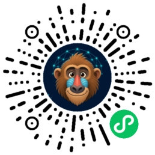

# material-reach

> 短视频素材搜集能力层 —— `grab` / `codec-fix` / `index` / `doctor`，
> 一条命令把素材**真正落盘**：视频、封面、元数据、索引，拒绝「只有链接」。

[](LICENSE)
[](https://www.python.org)

## 为什么有这个项目

做短视频的人（和 AI Agent）每天都在「搜集素材」，但现状是：

- Agent 交回来一堆**链接**，点开就没了，无法进剪辑流程；
- YouTube 高清档只发 **AV1**，下载下来播放器黑屏只剩声音；
- yt-dlp 下载格式五花八门，选错就掉进 m3u8 碎片流（489 个 fragment 下载到天荒地老）；
- 并行下载两个视频，第二个**必吃 403**；
- B 站已经被 yt-dlp **412 全面风控**，搜都没法搜。

这些坑我们全部踩过一遍。material-reach 把踩坑经验固化成一条命令：
**能力层不是壳**——它只做渠道路由、格式选择、编码兼容、落盘验证、索引管理，
真干活的是上游开源工具（yt-dlp / ffmpeg / bili-cli），不额外包一层数据流。

## 安装

```bash
pip install .            # 本仓库
# 或安装后补齐上游工具
pip install bilibili-cli # B站检索（可选）
mr doctor                # 体检：缺什么、怎么修，处方式输出
```

依赖：Python 3.9+、ffmpeg（PATH 里要有 `ffmpeg`/`ffprobe`）、Node.js（yt-dlp 过 YouTube 机检用）。

## 快速上手

```bash
# 1. 体检素材链路
mr doctor

# 2. 抓素材（按 URL 自动路由渠道）
mr grab "https://www.youtube.com/watch?v=xxxx" --out 素材库/我的选题
mr grab "https://www.bilibili.com/video/BVxxxx" --out 素材库/我的选题   # 元数据落盘
mr grab "https://some.blog/post"               --out 素材库/我的选题   # 标题+封面

# 3. 编码体检（治「只有声音没画面」）
mr codec-fix 素材库/ --check     # 列出 AV1/VP9 待修复
mr codec-fix 素材库/             # 转码 H.264，原文件自动备份

# 4. 盘点交付
mr index 素材库/                 # 产出 INDEX.jsonl + INDEX.md
```

## 能力矩阵

| 命令 | 干什么 | 精华在哪 |
|---|---|---|
| `mr doctor` | 素材链路体检 | 真执行上游命令探测（非 which 纸面检查），处方式修复提示 |
| `mr grab` | 按 URL 渠道抓取落盘 | YouTube 格式候选链（`136+140-19 → mp4 合轨 → 18`）避开 m3u8 碎片流；串行纪律防 403；落盘即 ffprobe 验证 |
| `mr codec-fix` | AV1/VP9 → H.264 | 治 YouTube 高清档 AV1 黑屏；原文件自动备份不覆盖 |
| `mr index` | 素材库盘点 | INDEX.jsonl（机器可读，喂给 Agent）+ INDEX.md（人话表格） |

### 渠道边界（如实告知，不硬撑）

| 渠道 | 落盘内容 | 边界 |
|---|---|---|
| YouTube | 视频(H.264)+封面+元数据 | 高清档可能只有 AV1，用 `codec-fix` 兜底 |
| Bilibili | 元数据 YAML（标题/简介/互动数据/字幕可用性） | **视频文件不支持下载**（yt-dlp 被 412），需浏览器方案 |
| 网页 | 标题+og:image 封面+元数据 | SPA 页面可能拿不到 og 图 |

## 与 Agent Reach 的关系

本项目受 [Agent Reach](https://github.com/Panniantong/Agent-Reach)（MIT, 99k★）启发：
它的「能力层不包壳、多后端有序候选、doctor 体检、SKILL.md 路由」设计被本仓库继承。
差异在场景——Agent Reach 解决「Agent 怎么连上各平台」，material-reach 解决
「**素材怎么真正落进硬盘并可直接进剪辑流程**」：格式候选链、编码兼容性转码、
封面抽取、落盘验证、双格式索引，这些是短视频创作者的真实工作流。
两个项目互补，可同时使用（登录态平台走 Agent Reach，素材落盘走 material-reach）。

## 给 Agent 用

仓库根目录的 [`SKILL.md`](SKILL.md) 是标准的 Agent Skill 描述：
把它放进你的 Agent 技能目录（如 `~/.openclaw/skills/material-reach/`），
Agent 即可在大白话需求（"帮我搜集 X 的素材"）触发时正确调用上述命令。

## 素材库目录规范

```
素材库/<选题>/
├── video/        视频成片（统一 H.264/AAC yuv420p）
├── cover/        封面帧 / og:image
├── meta/         元数据（B站 YAML / 网页 MD）
├── INDEX.jsonl   机器可读索引（grab 自动追加）
├── INDEX.md      人话表格
└── raw/          原始备份（codec-backup 等）
```

## Roadmap

- [ ] `mr asr`：本地 faster-whisper 音频转文字（字幕/口播稿一键出）
- [ ] `mr scene`：ffmpeg scene 检测切镜频率分析（对标拆解）
- [ ] B 站字幕读取（bili-cli AI 字幕接口）
- [ ] 小宇宙播客 m4a 直链提取 + 转写

## 找到作者

实测踩坑记录、AI 工作流技巧都在公众号「**狒狒AI**」；开箱即用的资料包在小程序「**狒狒AI资料库**」。

<p align="center">
  
  &nbsp;&nbsp;&nbsp;&nbsp;
  
</p>

<p align="center"><b>公众号「狒狒AI」</b>（实测踩坑 + 工作流）&nbsp;&nbsp;·&nbsp;&nbsp;<b>小程序「狒狒AI资料库」</b>（资料包领取）</p>

## License

MIT
